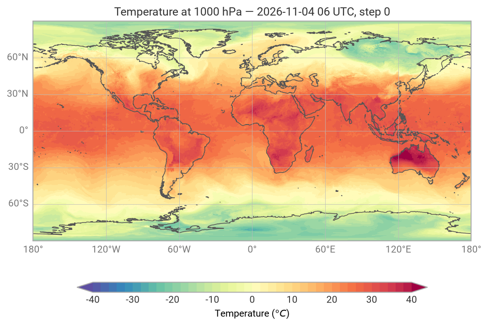
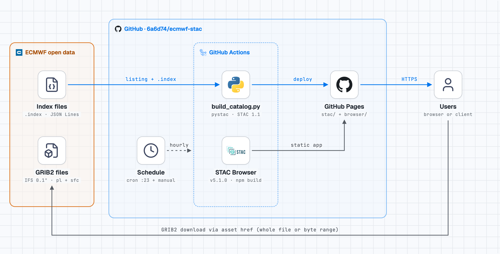

# INFCOM-4/SG-FIT side event   
  
  
Side event description:  
> **++Move Less Data: Preparing WMO Infrastructure for APIs, Cloud and AI++**   
> 
> Data volumes are outgrowing the file-based approach that has served WMO data exchange for decades. The Study Group on Future Data Infrastructure presents key findings and recommendations for part of INFCOM’s future work plan pertaining to WIS2. A live demonstration shows next-generation APIs extending data’s reach to all Members and providing analysis-ready data.  
  
A more detailed description (now superseded) is below:  
> Data volumes are outgrowing the push-based model that has served WMO for decades: ERA5 alone is 12 petabytes, and ECMWF now produces around 480 TB of raw data each day. The Study Group on Future Data Infrastructure (SG-FIT) worked on assessing what this means for WIS, WIGOS, WIPPS and Members' own systems. This side event presents the Study Group's key findings and what they imply for INFCOM's future work plan. It examines the growing demand for curated, high-quality datasets to train and run AI models and the policy questions that demand raises. A live demonstration will show "least-disruptive" technologies in action: WIS2-aligned data discovery, subsetting and visualization of analysis-ready, cloud-optimized forecast data through next-generation APIs, extending the reach of data for the benefit of all Members. We then turn to participants: what is actually blocking adoption of APIs, cloud and AI in your organization? Your input will help shape INFCOM's priorities.  
  
### Video snippets:  
* In case the demo’s services are unavailable - or, in the case of real-time notifications from WIS2, require the arrival of live data  
* These snippets can play in the WIS2 booth when it’s unattended  
* Separate snippet for each stage of the demo  
* Content: screen share and voice-over; no need for a talking head on the screen  
* Script: provide a script / notes to complement the demo-video - explainers for humans who try to replicate the demo (URLs, installation pre-requisites, etc.)  
* Creating: on a Mac, record with Quick-time (which is also good for editing out errors and replays)  
  
### Architecture diagrams:  
* For each stage of the demo - as an explainer for the “moving parts” involved  
* Perhaps try to automatically build - use “stack-diagram” skill ++[caru-ini/stack-diagram: Agent skill: describe your stack in a sentence, get an architecture diagram…](https://github.com/caru-ini/stack-diagram)?++  
  
### Outline:  
[inputs:   
1. Presentation - sg-fit-slides-for-infcom-4-pre-brief-session   
2. Paolo Mazzetti, died 11-August-2026 from natural causes while at home  
3. Presentation - Day3_Tandy_WMO-cloud-optimized-future-data-infrastructure v2  
4. grib-utils (based on ECMWF earthkit): grib_inspect.py, grib_plot.py, grib_index.py, grib_grid.py, README.md << ==share ~/Development/grib-utils-2026-11-05.zip package which you can install locally==  
5. WCMP2 record for urn-wmo-md-io-wis2dev-metdx-demo-ecmwf-opendata-ifs-0p1-oper (in progress, not shared; currently only a local resource at ~/projects/no-code-wis2-metadata-publication-metdx-demo/drafts/urn-wmo-md-io-wis2dev-metdx-demo-ecmwf-opendata-ifs-0p1-oper.json)  
6. STAC catalog for urn-wmo-md-io-wis2dev-metdx-demo-ecmwf-opendata-ifs-0p1-oper (based loosely on Microsoft Planetary Computer STAC catalogue records for ECMWF data; generated dynamically with GitHub workflow on 6a6d74/ecmwf-stac; [catalog](https://6a6d74.github.io/ecmwf-stac/stac/collection.json), [browser](https://6a6d74.github.io/ecmwf-stac/browser/)) << ==plan to deploy this workflow into wmo-im/metdx-demo==  
]  
  
60 minute duration.  
Jeremy presenting unless otherwise indicated.  
  
— 5 mins (5) —   
* **Introduction** to SG-FIT: purpose, membership (ref. Paolo: RIP [2]) incl. “associates” (AW, JH, MB, CL), 2024 workshop, three working themes (see [1]: notes from slide 2)  
* **Positioning**: The data challenge ([1] slide 4), Four ways not to move all the data ([1] slide 5), Three themes - one pathway ([1] slide 6)  
— 5 mins (up to 10 mins) (10) —    
* **Cloud Adoption Guidelines** - Miruna STOICESCU (EUMETSAT) and Joseph MANI (NOAA) to present remotely; building on [1] slide 13 [==pending: Miruna and Joe to provide slides and confirm timing==]  
— 10 mins (20)—   
* **Least Disruptive**: describing the technology and proposals ([1] slides 7-12) - finish by referencing the live demo coming later in the session  
— 5 mins (25) —   
* **Role of AI** - David RICHARDSON (ECMWF, WMO Chair SC-WIPPS) and Kanghui ZHOU (CMA, on-line) to present; building on [1] slides 14-16 and advertising the “From Exploration to Implementation: Advancing AI/ML in WIPPS” side event the following day (12-13h cet, 26-NOV); important to avoid overlap between the two side events AND ensure we don’t leave gaps [==pending: coordination with David (and Yuki) to agree scope of this section==]  
— 5 mins (30) —  
* **Recap**: three themes - one pathway ([1] slide 17)  
* **Next steps**, 2027-2028 ([1] slide 18)  
— 20 mins (50) —   
* DEMO - based on eight steps from [3], slides 12-19; Tom Kralidis to drive? << ==Use a single dataset as a ‘golden thread’ through the demo? Suggest urn-wmo-md-io-wis2dev-metdx-demo-ecmwf-opendata-ifs-0p1-oper==  
<< ==Both STAC and OGC-API use "rel":"collection" - should we use the “profile” attribute in the link block to distinguish between them?==  
<< ==WCMP2 [record urn:wmo:md:int-ecmwf:weather.prediction.forecast.global](https://wmo-resource-catalogue.labs.wis2dev.io/collections/wis2-discovery-metadata/items/urn:wmo:md:int-ecmwf:weather.prediction.forecast.global?f=json) uses separate link blocks for OGC-API EDR and OGC-API Maps (both "rel":"collection”) - should we be pointing to a single (OGC-API Common) collection resource that describes *both* the EDR and Maps services?==  
  
Step 1: Find the dataset  
        - Setup:   
            - [labs.wis2dev.io](https://labs.wis2dev.io) Global Discovery Catalogue [https://wmo-resource-catalogue.labs.wis2dev.io/collections/wis2-discovery-metadata/](https://wmo-resource-catalogue.labs.wis2dev.io/collections/wis2-discovery-metadata/)  
            - Use “metdx-demo” keyword to make our demo metadata records easy to find  
        - Clarify terminology for “dataset”: in WIS2 context it’s a whole basket of resources - not an individual data file  
        - Search [labs.wis2dev.io](https://labs.wis2dev.io) for a dataset (==watch for auto-correct shenanigans if you type “metdx-demo”==) << ==which dataset? urn-wmo-md-io-wis2dev-metdx-demo-ecmwf-opendata-ifs-0p1-oper==  
        - Talk about the “metadata driven workflow” (ref. back to “Four mechanisms, one workflow”; [1] slide 10)   
        - Show the links in the HTML page  
        - Show the links in JSON; very brief overview of a links object, highlight “rel”:”collection” as being the machine-readable instruction that says “this is a link to an interactive data resource” (e.g., an OGC or STAC API)  
        - [We’ll show the links in action during the rest of the demo] << ==note that collection links from urn:wmo:md:int-ecmwf:weather.prediction.forecast.global resolve to JSON pages (as expected); urn:wmo:md:ca-eccc-msc:msc-weather-forecast collection link (“Data access via API”) goes to pygeoapi UI==  
  
Step 2: The data is a pile of GRIB files  
        - Example dataset: urn:wmo:md:int-ecmwf:opendata … text/html link to ECMWF Open Data portal [https://data.ecmwf.int/](https://data.ecmwf.int/) << ==this isn’t really a dataset per se, so we probably want to focus on the IFS Global model data==  
            - Show the links in the WCMWP2 record: [Web Accessible Folder](https://data.ecmwf.int/) << ==add this links to the record, “rel”:”items”==  
            - Web Accessible Folder (WAF) user interface; navigate the directory path  
            - One folder per day,  plus “wis2” folder that only includes the WIS2 discovery metadata - not the data itself; all fine, but the user isn’t given any extra context about what is in each folder - they have to guess (albeit it’s fairly obvious for an *informed* human) << ==include link in the record to documentation pages in the WCMP2 record==  
                - Show & follow link to documentation pages [https://www.ecmwf.int/en/forecasts/datasets/open-data](https://www.ecmwf.int/en/forecasts/datasets/open-data)  
            - opendata/20261104/06z/ifs/0p1/oper/ folder includes “grib2” files   
                - “06z” is the run, “ifs” is the model, “0p1” is the resolution (0.1degree), “oper” is the stream (the ECMWF system that creates the data  
            - file: [20261104060000-0h-oper-fc-pl.grib2](https://data.ecmwf.int/ecpds/home/opendata/20261104/06z/ifs/0p1/oper/20261104060000-0h-oper-fc-pl.grib2)   
            - Download the file to inspect - it’s 380MB  
            - Inspect the downloaded file using grib-utils/grib_inspect.py [4] (ECMWF Earthkit under the covers: earthkit-data 1.3.1)  
  
```
python grib_inspect.py file.grib2
```
  
```
File:     /Users/jeremy/Downloads/20261104060000-0h-oper-fc-pl.grib2
Messages: 140

Date      Time  Step  StepType  LevelType
20261104   600     0  instant   isobaricInhPa

Grid / encoding (from first message):
  centre                               ecmf
  edition                              2
  marsClass                            od
  marsStream                           oper
  marsType                             fc
  gridType                             regular_ll
  Ni                                   3600
  Nj                                   1801
  iDirectionIncrementInDegrees         0.1
  latitudeOfFirstGridPointInDegrees    90.0
  latitudeOfLastGridPointInDegrees     -90.0
  longitudeOfFirstGridPointInDegrees   180.0
  longitudeOfLastGridPointInDegrees    179.9
  packingType                          grid_ccsds
  bitsPerValue                         16

Parameters (10):
  short   paramId  units        name                         levels
  z           129  m**2 s**-2   Geopotential                 10, 50, 100, 150, 200, 250, 300, 400, 500, 600, 700, 850, 925, 1000
  gh          156  gpm          Geopotential height          10, 50, 100, 150, 200, 250, 300, 400, 500, 600, 700, 850, 925, 1000
  t           130  K            Temperature                  10, 50, 100, 150, 200, 250, 300, 400, 500, 600, 700, 850, 925, 1000
  q           133  kg kg**-1    Specific humidity            10, 50, 100, 150, 200, 250, 300, 400, 500, 600, 700, 850, 925, 1000
  w           135  Pa s**-1     Vertical velocity            10, 50, 100, 150, 200, 250, 300, 400, 500, 600, 700, 850, 925, 1000
  vo          138  s**-1        Vorticity (relative)         10, 50, 100, 150, 200, 250, 300, 400, 500, 600, 700, 850, 925, 1000
  d           155  s**-1        Divergence                   10, 50, 100, 150, 200, 250, 300, 400, 500, 600, 700, 850, 925, 1000
  r           157  %            Relative humidity            10, 50, 100, 150, 200, 250, 300, 400, 500, 600, 700, 850, 925, 1000
  v           132  m s**-1      V component of wind          10, 50, 100, 150, 200, 250, 300, 400, 500, 600, 700, 850, 925, 1000
  u           131  m s**-1      U component of wind          10, 50, 100, 150, 200, 250, 300, 400, 500, 600, 700, 850, 925, 1000
```
  
        - Plot the downloaded file using grib-utils/grib_plot.py [4] (ECMWF Earthkit under the covers: earthkit-data 1.3.1, earthkit-plots 1.0.4)  
  
```
python grib_plot.py file.grib2 plot.png --param t --level 1000
```
  
  
  
Step 3: Which file do I actually need?  
        - Example dataset: urn:wmo:md:int-ecmwf:opendata  
            - opendata/20261104/06z/ifs/0p1/oper/ includes “index” files that describe what is in each GRIB2 file - so you don’t have to download 380MB per file to figure that out  
            - JSON format - but non-standard  
            - file: [20261104060000-0h-oper-fc-pl.index](https://data.ecmwf.int/ecpds/home/opendata/20261104/06z/ifs/0p1/oper/20261104060000-0h-oper-fc-pl.index)   
            - Download the file to read the index; approx 30KB, describing the 380MB GRIB2 file (~0.01% size)  
            - This index describes exactly that one GRIB2 file: .index files matched to .grib2 files by basename, there's no filename, URL or checksum  
            - Read the downloaded index file grib-utils/grib_index.py [4] (simple python, no Earthkit)   
  
```
python grib_index.py file.index.json
```
  
```
Index:    /Users/jeremy/Downloads/20261104060000-0h-oper-fc-pl.index.json
Messages: 140

Date      Time  Step  LevelType  Messages
20261104  0600     0  pl         140

File-wide MARS keys:
  class                                od
  stream                               oper
  type                                 fc
  expver                               0001
  domain                               g

Byte layout:
  first offset                         0
  sum of message lengths               380,168,143 bytes
  expected GRIB file size              380,168,143 bytes
  gaps / overlaps                      0 / 0
  message size min / max               154,723 / 5,718,171 bytes

Parameters (10):
  param           bytes  levels
  z          63,426,585  10, 50, 100, 150, 200, 250, 300, 400, 500, 600, 700, 850, 925, 1000
  gh         25,520,103  10, 50, 100, 150, 200, 250, 300, 400, 500, 600, 700, 850, 925, 1000
  t          16,133,026  10, 50, 100, 150, 200, 250, 300, 400, 500, 600, 700, 850, 925, 1000
  q          22,006,909  10, 50, 100, 150, 200, 250, 300, 400, 500, 600, 700, 850, 925, 1000
  w          47,487,031  10, 50, 100, 150, 200, 250, 300, 400, 500, 600, 700, 850, 925, 1000
  vo         50,645,164  10, 50, 100, 150, 200, 250, 300, 400, 500, 600, 700, 850, 925, 1000
  d          58,898,976  10, 50, 100, 150, 200, 250, 300, 400, 500, 600, 700, 850, 925, 1000
  r          18,710,357  10, 50, 100, 150, 200, 250, 300, 400, 500, 600, 700, 850, 925, 1000
  v          40,729,215  10, 50, 100, 150, 200, 250, 300, 400, 500, 600, 700, 850, 925, 1000
  u          36,610,777  10, 50, 100, 150, 200, 250, 300, 400, 500, 600, 700, 850, 925, 1000
```
  
Step 4: Real-time: publish / subscribe  
[ ==TODO … Show the pub/sub links in the WCMP2 record; retrieve the subscription (and wis2downloader) config from GDC; use MQTT client (EMQX/MQTTX Web) to show WNM arriving (or arrived!) on the topic; show the WNM and focus on the links - particularly the canonical link to the data object; follow the link and show the data object; now add configuration to wis2downloader (or show existing configuration); show GRIB files downloaded from WIS2== ]  
  
~~Step 5:~~   
  
Step 6: Standardize the index: STAC   
        - This is where the recommendations from SG-FIT start - steps 1-4 are used WIS2 already  
        - Show the links in the WCMWP2 record: HTML [browser](https://6a6d74.github.io/ecmwf-stac/browser/), JSON [catalog](https://6a6d74.github.io/ecmwf-stac/stac/collection.json) << ==add these links to the record==  
        - Browse the STAC catalog [6]: HTML [browser](https://6a6d74.github.io/ecmwf-stac/browser/), JSON [catalog](https://6a6d74.github.io/ecmwf-stac/stac/collection.json)  
        - Find the same GRIB and Index resources that were inspected/plotted in Steps 2 and 3  
        - STAC browser is open-source; it reads JSON files that were automatically generated from the ECMWF open data using a python script; deployed as a workflow on GitHub it publishes the JSON resources to GitHub-Pages so they publicly reachable; the workflow is scheduled to run once per hour to check for new open-data; generating the entire STAC catalogue takes only 1-2 minutes, reading the Index files rather than having to download the GRIBs themselves   
            - *Aside: First time only the workflow downloads one GRIB message per parameter, fetched by HTTP byte range to read names, units and the grid. This is cached in .cache/grib-metadata.json.*   
        - TL;DR - the STAC catalog describes the set of GRIBs as a data-cube  
        - How do STAC items compare with .index files? The Items are a small fraction of the size of the ECMWF index files for the same run …  
            - Pressure levels (00z/12z run): one STAC Item of about 86 KB, against 85 index files totalling about 2.6 MB.  
            - Surface (00z/12z run): one STAC Item of about 105 KB, against about 0.9 MB of index files.  
            - Whole catalog: about 1.9 MB of STAC Items, against roughly 35 MB of index files.  
            - The two do different jobs. The index files give byte offsets so you can fetch a single field from a GRIB2 file. The STAC Items describe each run's time, grid, variables and files so you can find the data.  
  
  
  
[==Conflate with “Step 5: One message per file is a lot of messages” - contrary to my earlier thinking there is one .index file for each .grib (purpose - provide metadata for the grib2 file *and* byte-offsets for individual GRIB fields); after working through the STAC section, add that “one WNM message per GRIB file is a lot of messages; WIS2 easily scales to handle this traffic volume, but it’s a lot for users to manage; a possible change is to point a WNM at the STAC collection for a model run to notify users when it is available; if  “early access” to data is needed while a model run is still in progress, could publish WNM for a STAC item pointing to an incomplete (but self-consistent) set of GRIBs, and republish the STAC item with rel=update and new pubtime when more data is available==]   
  
Step 7: Work at the dataset level: virtual Zarr  
[ ==TODO … Show the links in the WCMP2 record; run an xarray command to interrogate the (virtual) Zarr resource; show the Zarr-store metadata; run a Jupyter notebook (local deployment) that illustrates solar energy forecast (configurable parameters for the calculation) - demonstrates “power user access” … possible: Earthmover/Arraylake catalogue with authn/authz== ]   
  
Step 8: For the rest of us, a Web API  
[ ==TODO … Show the links in the WCMP2 record; recap on the “metadata driven workflow” (ref. back to “Four mechanisms, one workflow” [1] slide 10); use metdx-demo UI client to interact with data through OGC APIs== ]  
  
And Beyond: integration with AI agents << ==do we have time for this?==  
[ ==TODO … Show link to MCP server in the record; get Claude to build a plot and/or a chart from a text prompt thanks to the instructions gleaned from the MCP server== ]  
  
… highlight the “metadata driven workflow” once again  
  
Possible inclusion:  
- GeoWeb end-points  
- Monitoring traffic flow: data volumes downloaded by the client - perhaps use a reverse proxy (e.g., Traffic) that can provide metrics/dashboard that show how much data is downloaded by the client during the demo - compare this with the size of the complete dataset  
- Iceberg vs. Icechunk Earthmover blog ([https://www.earthmover.io/blog/weather-forecast-data-icechunk-vs-iceberg/](https://www.earthmover.io/blog/weather-forecast-data-icechunk-vs-iceberg/)): data volumes assessment  
  
— 5 mins (55) —   
* **Q&A** (using Mentimeter [https://www.mentimeter.com/](https://www.mentimeter.com/) or Slido [https://www.slido.com/](https://www.slido.com/) - Anna Milan to set up): “What is actually blocking adoption of APIs, cloud and AI in your organisation? Your input will help shape INFCOM’s priorities.”  
    1. Are blocker(s) is of a technical nature or related to policies or the learning curve for staff?  
  
  
+++  
  
## grib-utils  
  
To set it up:  
```
cd ~/Development/grib-utils
python3 -m venv .venv && .venv/bin/pip install -r requirements.txt
export SSL_CERT_FILE=$(.venv/bin/python -c "import certifi; print(certifi.where())")
```
You only need SSL_CERT_FILE the first time the coastline data is downloaded. Use the .venv/bin/python interpreter for both scripts.  
  
Run using the virtual environment (or activate the venv in your terminal session), e.g.:  
```
.venv/bin/python grib_inspect.py ~/Downloads/20261104060000-0h-oper-fc-pl.grib2
```
  
### Describe a GRIB file  
```
grib_inspect.py
```
- Prints the message count, the time/level-type combinations, the grid and encoding keys, and one row per parameter (shortName, paramId, units, name and levels).  
- --stats 850 500 250 adds min, mean and max for those levels, and --param t u limits that to the parameters you name.  
- The mean is now weighted by latitude, so polar points no longer count too much. The 850 hPa temperature mean moves from 274.8 K to 281.4 K.  
- Levels sort as numbers (10, 50, … 925, 1000).  
  
```
grib_inspect.py FILE [--stats LEVEL ...] [--param SHORTNAME ...]

┌───────────────────┬──────────────────────────────────────────────────────────────┐
│     Argument      │                           Meaning                            │
├───────────────────┼──────────────────────────────────────────────────────────────┤
│ FILE              │ GRIB file to read (required)                                 │
├───────────────────┼──────────────────────────────────────────────────────────────┤
│ --stats 850 500 … │ Also print min, mean and max for every field on these levels │
├───────────────────┼──────────────────────────────────────────────────────────────┤
│ --param t u …     │ Limit --stats to these parameters                            │
└───────────────────┴──────────────────────────────────────────────────────────────┘

Examples:
python3 grib_inspect.py file.grib2                          # summary only
python3 grib_inspect.py file.grib2 --stats 850 500 250      # + stats, all params
python3 grib_inspect.py file.grib2 --stats 500 --param t gh # + stats, t and gh at 500 hPa
```
  
### Draw one GRIB field on a world map  
```
grib_plot.py
```
- Usage: grib_plot.py FILE OUT.png [--param t] [--level 850] [--units …] [--style auto|generic] [--title …] [--dpi 150].  
- The defaults reproduce the earlier 850 hPa temperature map, and the title now comes from the field's metadata.  
- A missing field gives a clear error message.  
  
```
grib_plot.py FILE OUTPUT [--param P] [--level L] [--units U] [--style auto|generic] [--title T] [--dpi N]

┌──────────┬─────────────────┬─────────────────────────────────────────────────────────────────┐
│ Argument │     Default     │                             Meaning                             │
├──────────┼─────────────────┼─────────────────────────────────────────────────────────────────┤
│ FILE     │ –               │ GRIB file to read (required)                                    │
├──────────┼─────────────────┼─────────────────────────────────────────────────────────────────┤
│ OUTPUT   │ –               │ Image to write, e.g. map.png (required)                         │
├──────────┼─────────────────┼─────────────────────────────────────────────────────────────────┤
│ --param  │ t               │ Parameter shortName: t, u, v, w, q, r, gh, z, vo or d           │
├──────────┼─────────────────┼─────────────────────────────────────────────────────────────────┤
│ --level  │ 850             │ Pressure level in hPa                                           │
├──────────┼─────────────────┼─────────────────────────────────────────────────────────────────┤
│          │ °C for t,       │                                                                 │
│ --units  │ otherwise       │ Units to convert to, e.g. km/h, g/kg, K                         │
│          │ native          │                                                                 │
├──────────┼─────────────────┼─────────────────────────────────────────────────────────────────┤
│          │                 │ auto uses earthkit's built-in colours; generic uses a colour    │
│ --style  │ auto            │ scale fitted to the data. Requesting non-default units switches │
│          │                 │  to generic automatically.                                      │
├──────────┼─────────────────┼─────────────────────────────────────────────────────────────────┤
│ --title  │ from metadata   │ Custom title                                                    │
├──────────┼─────────────────┼─────────────────────────────────────────────────────────────────┤
│ --dpi    │ 150             │ Image resolution                                                │
└──────────┴─────────────────┴─────────────────────────────────────────────────────────────────┘

Examples:
python3 grib_plot.py file.grib2 t850.png                                  # 850 hPa temperature, °C
python3 grib_plot.py file.grib2 gh500.png --param gh --level 500          # 500 hPa heights
python3 grib_plot.py file.grib2 u250.png --param u --level 250 --style generic   # jet stream, m/s
python3 grib_plot.py file.grib2 q850.png --param q --level 850 --units g/kg
```
  
### Read the JSON .index file for a GRIB2  
```
grib_index.py
```
- message count  
- the date, time, step and level-type combinations  
- the file-wide keys (class, stream, type, expver, domain)  
- a byte-layout check, which grib_inspect.py doesn't have  
- one row per parameter with its levels  
  
```
Examples:
python3 grib_index.py file.index.json --list --param t --level 850 500
```
  
### Understand the grid for a GRIB field (or file)  
```
grib_grid.py 
```
- Shows the grid geometry of a GRIB file using earthkit-data.   
- It prints the grid keys from the GRIB header (grid type, earth shape and radius, grid size, first and last grid points, spacing), then the latitudes and longitudes earthkit assigns to the data array.   
- It checks that every message in the file is on the same grid.   
- Use it for questions like "does this grid start at 0° or −180°?".  
  
```
Examples:
```
```
# Grid of the first message
```
```
python grib_grid.py file.grib2

```
```
# Grid of a particular message (counting from 1)
```
```
python grib_grid.py file.grib2 --message 5

```
```
# Show just the start and end longitudes
```
```
python grib_grid.py file.grib2 | grep -i longitude

```
```
# Usage
python grib_grid.py --help
```
  
